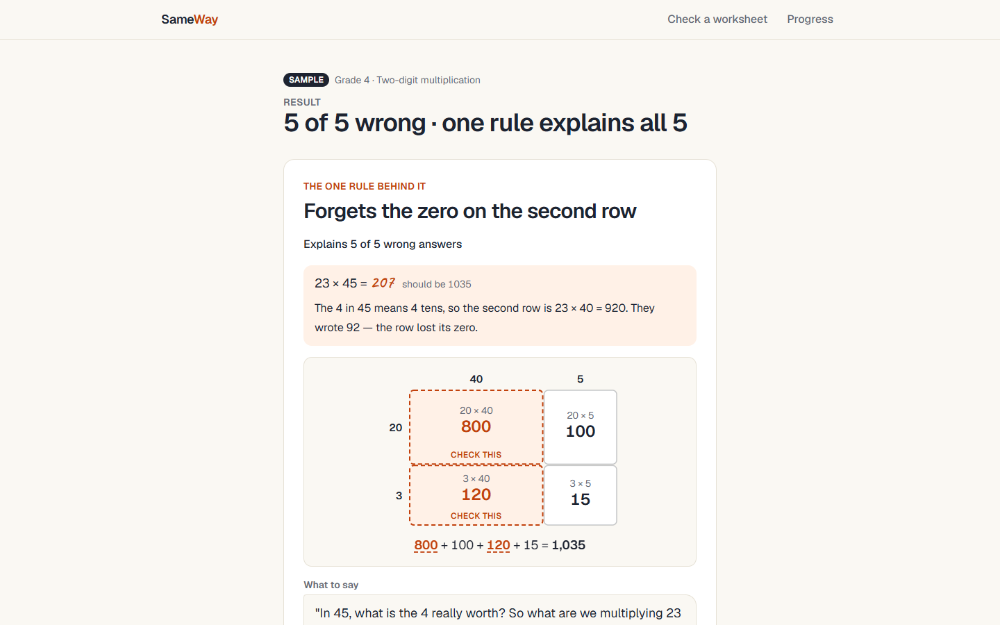

# SameWay

**See exactly why your kid got their math wrong, and fix it the way schools teach it.**

Live: **https://sameway-sigma.vercel.app** (no sign-up, works in any browser)



A parent snaps a photo of a grade 2–4 math worksheet. SameWay finds the one broken rule behind
the wrong answers, shows it on the model the school uses (area model, place-value columns), gives
the parent the words to say, and checks the fix with three practice problems.

Built solo for Business Cup 2.0 (AIESEC × Nazarbayev University × Zimran), a 24-hour hackathon.

## Try it in two minutes

1. Open the [live site](https://sameway-sigma.vercel.app) and pick **Try a sample worksheet → B**.
   The sample image is read by the same photo reader as a parent's own photo.
2. On **"Is this what's on the page?"**, change an answer (for example 207 → 815) and check again.
   The diagnosis changes: nothing is hardcoded.
3. Type `52-18=46` on its own for a single-answer diagnosis, or `300-187=287` for two rules that
   fit equally and one check problem that decides between them.
4. **Practice the fix** → three right answers → **Fixed ✓**. The rule shows up on `/progress` and
   survives a refresh.
5. Your first three own worksheets are free. Start a fourth to see the paywall and walk the
   checkout with the test card `4242 4242 4242 4242` (filled in for you).
6. On `/progress`, open **Demo: 3 weeks with Maya** to see what a returning family sees.

## Who it is for

A US parent of a 2nd–4th grader who helps with homework on weeknights. They know the right answer
but not *why* their kid's answer is wrong, and the school's methods aren't how they learned.
The parent pays: the first three own worksheets are free, then SameWay Plus is $9.99/month or
$59/school year (constants in [lib/pricing.ts](lib/pricing.ts)).

## Payment

A Stripe test-mode Checkout is written ([app/api/checkout](app/api/checkout)) and turns on when
`STRIPE_SECRET_KEY` is set; the live demo has no key, so it uses the built-in test checkout
instead, clearly labeled as a demo with no real payment.

## How it works

```
photo → vision model → {op, a, b, answer}[] → parent confirms → engine → verdict + picture + words + check problems
```

- **The model only transcribes.** One vision call ([lib/reader.ts](lib/reader.ts)) copies the
  problems and the child's answers off the photo. It is told not to solve or correct anything.
- **The parent confirms the table.** Every number is editable before the check, and rows the
  reader was unsure about are marked.
- **The engine diagnoses.** [lib/engine](lib/engine) is deterministic TypeScript that runs in the
  browser. Every verdict, number, sentence and picture comes from it, not from a model.
- **Typing works without the model at all.** If the reader fails or is rate-limited, the parent
  types the problems in and gets the same diagnosis.
- **Progress stays in the browser.** Each rule moves from *Found* to *Practicing* to *Fixed*,
  and a fixed rule that shows up on a later worksheet goes back to *Practicing*.

## The diagnosis engine

Each common mistake pattern is a pure function that returns the exact wrong answer it produces,
for example "subtracts the smaller digit from the bigger one" or "forgets the zero on the second
row". There are 14 rules, after Brown & Burton (1978) and VanLehn (1990). A wrong answer that
equals a rule's output is a diagnosis, not a guess.

- A wrong answer that fits no rule is checked for a single slipped fact (7 × 8 = 54) or one
  column off by 1–2. If that fails too, the app says it doesn't know.
- The whole worksheet is scored at once: how many wrong answers a rule explains, and where it
  should have shown up but didn't. The verdict is `pattern`, `tie`, `maybe`, `no-pattern` or
  `all-correct`.
- When two rules fit equally, the engine builds one check problem on which they predict different
  answers.
- "Fixed" means the child passes three new problems on which the rule would go wrong.

Scope: + and − up to 9,999, multi-digit × one digit, and 2-digit × 2-digit. Anything else is
shown as "Not covered yet".

### Validation

`npm run simulate` checks every grade 2–4 problem exhaustively (1.24M problems, about 10 s):

| Question | Result |
|---|---|
| One wrong answer points to exactly one rule | 86% of cases on average; 71–100% for 12 of the 14 rules |
| Two rules give the same answer: does one check problem tell them apart? | 477 of 477 sampled cases |
| 6-problem worksheet, the rule followed every time | Named correctly in 88–100% of cases |
| Same, with 10% random slips and the rule followed 80% of the time | Named in 53–81% of cases; the rest go to a check problem; a wrong rule named at most 1.8% of the time |
| Kids with no broken rule and 15% random slips | Called a pattern 0% of the time |

These kids are simulated. Accuracy on real worksheets still has to be measured.
Design notes and how to add a rule: [ENGINE.md](ENGINE.md).

## Run locally

```bash
npm install
cp .env.example .env.local   # fill in the values below
npm run dev                  # http://localhost:3000
npm test                     # unit tests (engine, parsing, progress, pricing, …)
npm run build
npm run simulate             # the validation above
```

The app runs without any keys: typing and the diagnosis work, samples fall back to their saved
transcription, and the paywall opens the built-in demo checkout.

### Environment variables

| Variable | What it is |
|---|---|
| `GOOGLE_GENERATIVE_AI_API_KEY` | Google AI Studio key for the photo reader |
| `VISION_MODEL` | A Gemini Flash model id, e.g. `gemini-3.5-flash` |
| `VISION_MODEL_FALLBACK` | A different Flash model id, e.g. `gemini-3.5-flash-lite`. Quotas are per model, so it answers when the primary is busy or rate-limited |
| `STRIPE_SECRET_KEY` | Optional. A Stripe **test-mode** secret key (`sk_test_…`); without it the built-in demo checkout is used |
| `NEXT_PUBLIC_SITE_URL` | Public URL of the deployment, used for the checkout return links |

Keys live only in `.env.local` and in the Vercel project settings, never in the repo.

## Project layout

```
app/                 pages (landing, /check, /progress, /upgrade/success) and API routes
app/api/read         photo → problems (the only model call)
app/api/checkout     Stripe Checkout Session + verification
components/          the check flow, AreaModel, PlaceValue, Practice, Paywall, …
lib/engine/          the diagnosis engine and its tests
lib/                 parsing, photo resize, progress storage, samples, demo, pricing
scripts/simulate.ts  the exhaustive validation
```

## Key dependencies

- **Next.js** (App Router), **TypeScript** (strict), **Tailwind CSS**, deployed on **Vercel**.
- **Vercel AI SDK** with **Google Gemini Flash on the free tier** (`@ai-sdk/google`) for reading
  the photo. A launch would use the paid tier, where inputs aren't used to improve Google's products.
- **Stripe** Checkout in test mode, with inline prices and no webhooks (on when a key is set).
- **zod** for validating the reader's output and saved progress; **vitest** for tests.
- No database, no accounts, no analytics.

## Privacy

- Photos are resized in the browser, sent to `/api/read`, and forwarded to the Gemini API only to
  read the numbers. SameWay never stores or logs them.
- On Gemini's free tier, Google may use API inputs to improve its products. That is acceptable for
  a hackathon demo with our own sample sheets, and it is why a launch would move to the paid tier.
- The sample worksheets are drawn by the app in a handwriting font. They are not real children's work.
- The product is for parents. The model only transcribes a photo the parent uploads; the child
  never talks to an AI.
- No accounts and no emails. Progress, the child's optional first name and the Plus status stay
  in this browser's localStorage.

## Sources
- DreamBox Learning parent survey (Nov 2024): https://www.dreambox.com/math/guides/new-math-vs-old-math
- NAEP 2024 Mathematics, Grade 4: https://www.nationsreportcard.gov/reports/mathematics/2024/g4_8/national-trends/?grade=4
- Brown & Burton (1978), "Diagnostic models for procedural bugs in basic mathematical skills", Cognitive Science 2(2)
- VanLehn (1990), "Mind Bugs: The Origins of Procedural Misconceptions", MIT Press
- Competitor features from public product pages (Photomath, Methodwise, Eedi), Nov 2026
